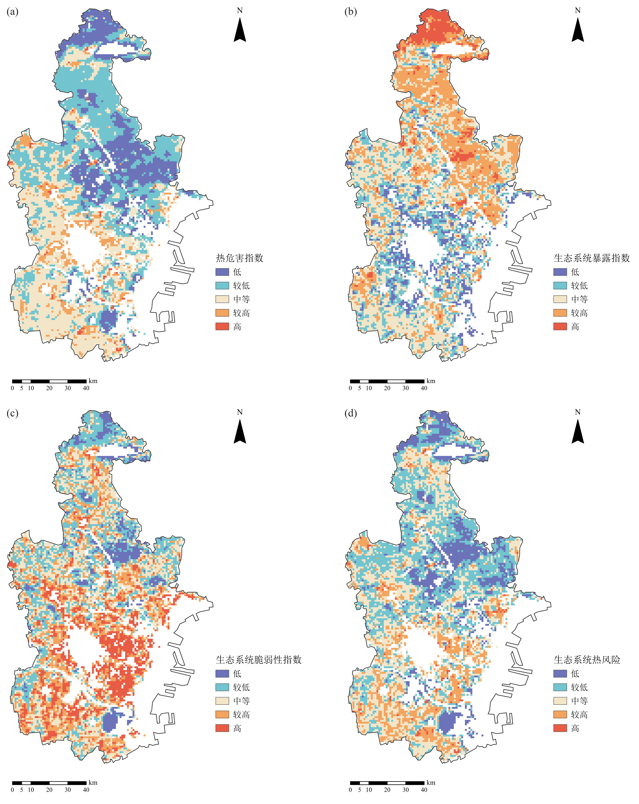
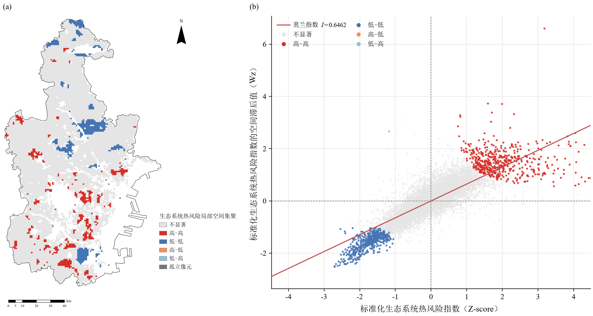
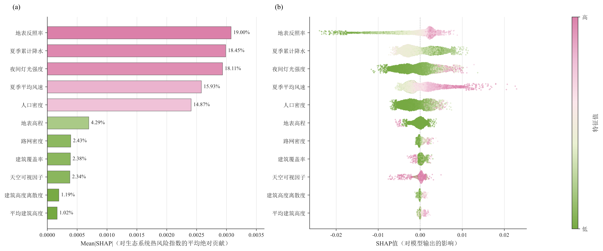
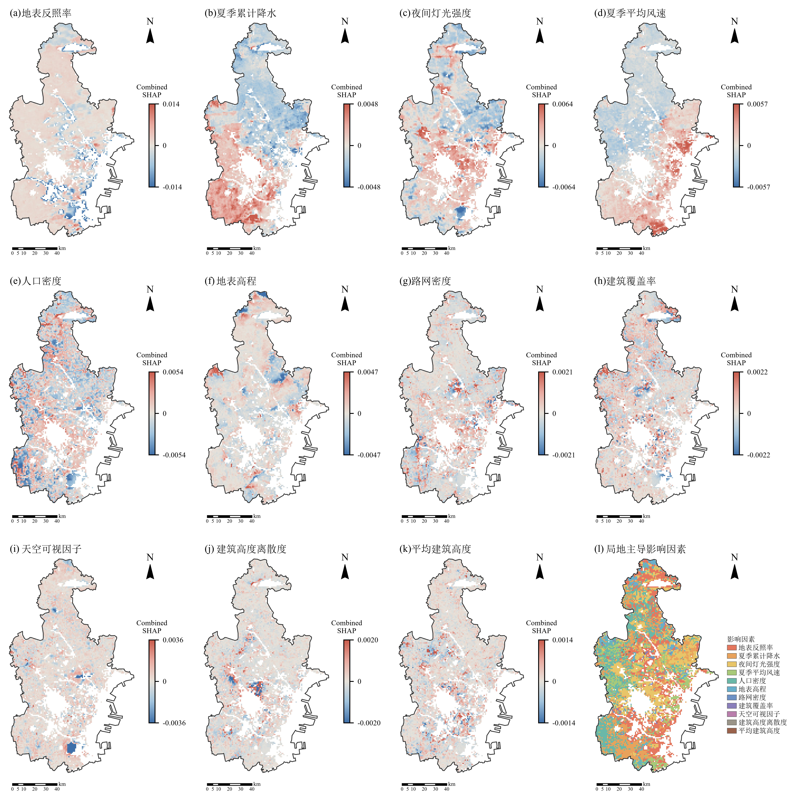

# Tianjin Ecosystem Heat-Risk Analysis

Research code exploring the spatial patterns and potential drivers of ecosystem
heat risk in Tianjin, China. The project combines geospatial analysis, global
random forests, SHAP interpretation, and geographically weighted random forests.

天津市生态系统热风险研究代码，涵盖空间分析、全局随机森林、SHAP 与混合地理加权随机森林。

## My contribution

I independently performed all data processing for this study, including the
preparation and spatial harmonisation of the research datasets. The code and
figures below present the study's spatial and machine-learning analyses.

## Selected results

The study covers 8,981 valid 1 km land grid cells, combining 2022 heat hazard
with 2021 ecosystem exposure and vulnerability indicators.

**Spatial risk patterns.** Higher-risk patches occur mainly in southern and
western Tianjin and parts of the western Binhai area. Panels (a-d) show heat
hazard, ecosystem exposure, vulnerability and their combined risk index.



**Spatial clustering.** The manuscript reports global Moran's I = 0.6462
(p < 0.001). The LISA map distinguishes high-high and low-low clusters from
spatial outliers and non-significant cells.



**Global SHAP interpretation.** Surface albedo, summer precipitation, nighttime
lights, summer wind speed and population density account for 86.36% of the
normalised mean absolute SHAP importance in the fitted global RF. This is a
share of model attribution, not a percentage of risk or variance explained.



**Local contributions and dominant factors.** Panels (a-k) map signed Combined
GWRF SHAP contributions; panel (l) identifies the factor with the largest absolute
combined contribution at each cell. These are contributions to the combined
global/local prediction, not stand-alone local-model importance scores. The
factor that dominates a cell is not necessarily associated with a high risk level.



The original figure labels are in Chinese. English descriptions and a legend
translation are provided in the [figure guide](outputs/figures/README.md).

## Predictive performance

The following are existing research results under five-fold spatial-block
cross-validation with 10 km blocks and ten repeated fold assignments. They
have not been recomputed after the code was relocated.

| Model | Mean R² | Mean RMSE | Mean MAE |
|---|---|---|---|
| Linear regression | 0.299 | 0.01202 | 0.00855 |
| SVR | 0.419 | 0.01093 | 0.00738 |
| XGBoost | 0.448 | 0.01065 | 0.00725 |
| Global RF | 0.453 | 0.01061 | 0.00721 |
| Local GWRF | 0.443 | 0.01070 | 0.00719 |
| Combined GWRF | 0.473 | 0.01042 | 0.00698 |

Combining global and local predictions produced a modest increase in mean R²
of approximately 0.020 over global RF. The purely local model did not outperform
global RF in R² or RMSE. These results motivate examining where local
relationships help, while recognising that substantial predictive variation
remains unexplained. No claim of statistical significance is made for this gain.

See [research highlights and result provenance](docs/research_highlights.md).

## Research questions

- How does ecosystem heat risk cluster across space?
- How do heat hazard, exposure, vulnerability, and risk vary from the coast inland?
- Which environmental and urban factors are associated with heat risk?
- How do model contributions vary across locations?

## Methods and code

| Research component | Methods | Representative script |
|---|---|---|
| Spatial patterns | Global Moran's I, local Moran/LISA, permutations and FDR | [Spatial clustering](scripts/analyze_ecosystem_heat_risk_spatial_clustering.py) |
| Spatial scale | Distance-band correlation and empirical semivariograms | [Correlation scale](scripts/analyze_heat_risk_spatial_correlation_scale.py) |
| Coastal gradients | H/E/V/R distance-band summaries and bin-width sensitivity | [Coastal gradients](scripts/analyze_hevr_coastal_inland_gradient.py) |
| Global prediction | RF, XGBoost, SVR and linear regression; repeated spatial-block CV | [Model comparison](scripts/compare_global_ml_repeated_spatial_blocks.py) |
| Model interpretation | TreeSHAP importance, response patterns and interactions | [Global RF SHAP](scripts/analyze_rf_shap_global.py) |
| Spatially varying prediction | Adaptive neighbourhoods, bisquare weighting, global/local mixtures | [GWRF](scripts/run_gwrf_11f.py) |
| Local interpretation | Weighted combination of global and local SHAP | [Combined GWRF SHAP](scripts/calculate_combined_gwrf_shap.py) |

SHAP contributions describe fitted model behaviour; they are not evidence of
causal effects. Coordinates define spatial folds and neighbourhoods rather
than serving as predictors in the selected model scripts.

## Repository status

This research portfolio contains 11 selected analysis scripts and shared path/map
helpers. Original calculations and parameter values are retained; machine-specific
input and font paths have been replaced with local configuration. The relocated
scripts have received syntax and path checks, but the complete analysis has not
been rerun in this repository. Full research data are not included.

## Getting started

```powershell
conda env create -f environment.yml
conda activate tianjin-heat-risk
Copy-Item config/paths.example.toml config/paths.local.toml
```

Edit `config/paths.local.toml` to point to your prepared research workspace,
boundary and land-cover files. Local settings are excluded from Git. After
preparing inputs, run a selected analysis from the repository root:

```powershell
python scripts/analyze_ecosystem_heat_risk_spatial_clustering.py
```

See [script usage and dependencies](scripts/README.md) for input structures and
execution dependencies. The environment file lists dependencies; exact versions
have not yet been locked. The YAML configuration is reserved for future pipeline
refactoring; selected scripts currently read the TOML path configuration.

## Layout

```text
scripts/       Selected research scripts, path configuration and map helpers
config/        Portable path examples; local settings are ignored
docs/          Script inventory, methodology and data documentation drafts
data/          Data documentation and space for small examples
outputs/       Space for curated figures/tables; generated data are ignored
src/           Reserved package structure for future refactoring
```

## Data and outputs

Large rasters, NetCDF files, raw datasets and model checkpoints are excluded.
Scripts expect prepared 1 km research inputs; a complete public example dataset
is not included yet. Selected result figures are included above. Data-source
documentation is still being completed.

## Authorship and project context

All data processing was performed independently by the repository owner. Author
name, affiliation, contact details and any publication link are still to be added.
This repository does not claim that the manuscript has been published. Code
licensing will be added once the copyright holder has chosen a licence.

